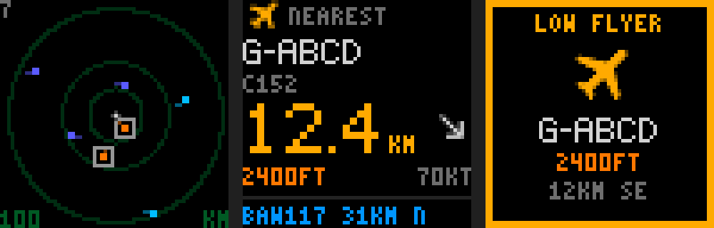
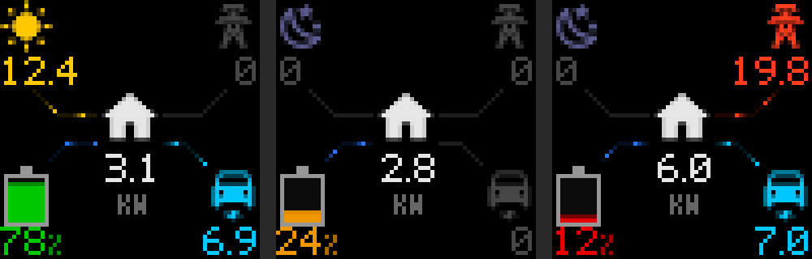
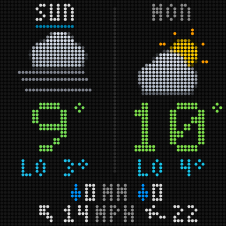
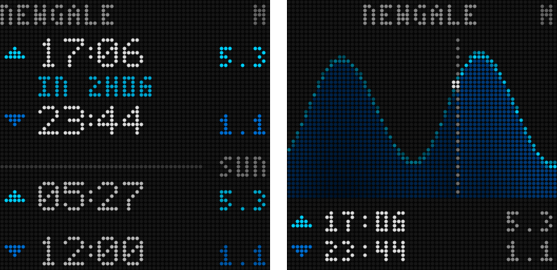

# WLED Matrix

An [AppDaemon](https://appdaemon.readthedocs.io/) app that shows Home Assistant values on **WLED LED matrices** (e.g. the 64×64 [Apollo M-1](https://apolloautomation.com/)) as simple screens of **icon + number + unit** items, laid out in rows or a grid, with screens on rotation.


- Draws everything itself in pure Python (pixel fonts; no Pillow needed).
- Uses **any [Material Design Icon](https://pictogrammers.com/library/mdi/)**, like Home Assistant (`mdi:transmission-tower`). Icons aren't stored here: the official `@mdi/js` package is downloaded once from jsDelivr, cached, and each icon is converted to pixels on the fly, with smoothed edges.
- Sends frames to WLED over **DDP** (UDP 4048), so WLED shows them as live data. If the app stops, WLED goes back to its own effect or preset after its realtime timeout.
- **Rows or a grid:** up to three big rows, or a grid with any number of rows and columns (cells can span), each cell sizing its icon and font to fit.
- Colours and icons can follow the value (thresholds), e.g. a battery icon and colour by charge level.
- Several matrices, each with its own screens and dwell time (a screen can set its own); an optional on/off entity per matrix.
- **Camera screens:** a Home Assistant camera's still, refreshed every `refresh` seconds while the screen is shown (needs Pillow).
- Any Home Assistant entity with a numeric state can be shown, and on/off entities (switches, lights, binary sensors) as `on`/`off`.
- **Aircraft screens:** live aircraft near home from your own ADS-B receiver (readsb / tar1090 `aircraft.json`, or a Home Assistant entity listing them): a **radar**, the **nearest aircraft**, a **departures board**, or a flashing **alert** for low flyers, helicopters and emergencies.
- **Power-flow screen:** solar, grid, battery, car and house joined by lines, with small comets moving the way the power flows, faster with more power (Victron or any other system with power sensors).
- **Weather screen:** today and tomorrow side by side from any Home Assistant weather entity: animated icons, the high and low coloured by temperature, rain and wind with an arrow.
- **Tide screen:** the next high and low waters as a table, or today's tide curve, from any entity listing them (e.g. the UKHO Tides integration for UK ports).
- **Conditional and priority screens:** show a screen only while an entity is on, or let it interrupt the rotation (e.g. an alert).
- **Animation:** a screen can set its own `frame_rate`, redrawn faster only while it's showing.
- **Night dimming:** dim every screen (and stop flashing and fast animation) between two times.

## Install

**HACS (custom repository):** HACS → ⋮ → Custom repositories → add this repository with category **AppDaemon**, then download "WLED Matrix". HACS needs AppDaemon apps enabled in its settings.

**Manual:** copy `apps/wled_matrix/` into your AppDaemon `apps` folder.

Then add a config to your `apps.yaml` (see below, and [`examples/apps.yaml`](examples/apps.yaml)).

**Restart AppDaemon after installing or updating the app.** AppDaemon only scans for new app folders at start-up, and it reloads `wled_matrix.py` but not its helper modules (`wm_*.py`), so an update can leave them out of step until a restart. Changes to your `apps.yaml` reload by themselves.

**Home Assistant OS, AppDaemon app 0.15 or later:** AppDaemon reads apps from its own folder, not from `/config/appdaemon/apps` where HACS installs them. Point it there with `app_dir: /homeassistant/appdaemon/apps` in `appdaemon.yaml`, e.g. with the app's `init_commands` option:

```yaml
init_commands:
  - mkdir -p /homeassistant/appdaemon/apps
  - "grep -q '^  app_dir:' /config/appdaemon.yaml || sed -i 's|^appdaemon:|appdaemon:\\n  app_dir: /homeassistant/appdaemon/apps|' /config/appdaemon.yaml"
```

## Configuration

```yaml
wled_matrix:
  module: wled_matrix
  class: WledMatrix
  refresh: 1                  # seconds between frames; keep below WLED's ~2.5 s realtime timeout
  # icon_cache: /config/wled_matrix_cache   # where the downloaded icon set is cached (default shown)
  matrices:
    - host: 192.168.1.50      # WLED device
      width: 64
      height: 64
      dwell: 10               # seconds per screen when there's more than one
      screens: [energy]
      enabled_entity: input_boolean.kitchen_matrix   # optional: only draw while this is on
  screens:
    energy:
      rows:
        - icon: mdi:battery
          icon_thresholds:          # pick the icon by value, like HA's battery icons
            - {above: 90, icon: mdi:battery}
            - {above: 70, icon: mdi:battery-80}
            - {above: 50, icon: mdi:battery-60}
            - {above: 30, icon: mdi:battery-40}
            - {above: 10, icon: mdi:battery-20}
            - {above: 0, icon: mdi:battery-outline}
          entity: sensor.battery_state_of_charge
          format: percent
          thresholds:
            - {above: 50, colour: [0, 190, 0]}
            - {above: 25, colour: [230, 150, 0]}
          colour: [230, 0, 0]
        - icon: mdi:power-plug
          entity: sensor.house_load_power
          format: power
          colour: [255, 150, 0]
        - icon: mdi:transmission-tower
          entity: sensor.grid_power
          format: power
          thresholds:
            - {above: 50, colour: [230, 0, 0]}
          colour: [0, 110, 255]
```

### On/off screens

```yaml
    heating:
      rows:
        - icon: mdi:water-boiler
          entity: switch.immersion
          format: onoff
          thresholds: [{above: 1, colour: [230, 40, 0]}]   # coloured when on
          colour: [70, 70, 70]                              # grey when off
```

### Grid screens

For more than three items, or items side by side, give a screen a `grid` and a list of `cells`. Each cell takes the same options as a row, plus its position:

```yaml
  screens:
    overview:
      grid: {rows: 4, columns: 2}
      cells:
        - {row: 0, col: 0, icon: mdi:battery-40, entity: sensor.battery_soc, format: percent}
        - {row: 0, col: 1, icon: mdi:thermometer, entity: sensor.outside_temperature, format: decimal1, unit: C}
        - {row: 1, col: 0, colspan: 2, icon: mdi:power-plug, entity: sensor.house_load_power, format: power}
        - {row: 2, col: 0, icon: mdi:transmission-tower, entity: sensor.grid_power, format: power}
        - {row: 2, col: 1, icon: mdi:solar-power, entity: sensor.pv_power, format: power}
```

A cell without an `entity` (or with `show_value: false`) shows just its icon, centred: handy as a label for the cells next to it (e.g. a `mdi:cable-data` cell spanning two rows beside download and upload rates).

Each cell sizes itself: the icon follows the cell height (up to 24 px), and the number uses big digits when they fit, otherwise the small font. The unit is left out if there's no room. `rowspan` and `colspan` merge cells. Screens with `rows` (as above) are a one-column grid.


Row / cell options:

| Key | Meaning |
|---|---|
| `icon` | `none` for no icon, any Material Design Icon as `mdi:<name>`, or a built-in pixel icon: `battery`, `plug`, `pylon`, `sun`, `thermometer` (these work offline) |
| `icon_thresholds` | List of `{above, icon}`, checked top to bottom; the first one the value reaches wins (else `icon`) |
| `font` | `small` always uses the small font (default: big when it fits), so neighbouring cells match |
| `align` | `left` (default), `center` or `right`: moves the icon and the number together within the cell, measured on the pixels actually drawn (e.g. centred temperature rows). Set it on a screen to apply to all its cells; a cell's own `align` wins |
| `show_value` | `false` shows only the icon, centred and coloured by `thresholds` (e.g. a switch's status icon) |
| `icon_size` | MDI icon size in pixels (default: the cell height, max 24) |
| `row`, `col`, `rowspan`, `colspan` | Grid screens only: the cell's position and size (from 0) |
| `entity` | Leave out for an icon-only cell. Any entity with a numeric state, or an on/off state with `format: onoff`. Unavailable or unknown shows `-` |
| `format` | `percent` (0–100, `%`), `power` (W, or kW from 1000 W), `number` (rounded), `decimal1` / `decimal2` (that many decimals), `mbps` (Mbit/s in: `M` with one decimal below 10, whole numbers to 999, then `G` in Gbit/s), `onoff` (shows `on`/`off` for switches, lights and binary sensors; on counts as 1 and off as 0 for `thresholds`) |
| `unit` | Override the unit text (characters available: `% W k C ° h M G`) |
| `colour` | `[r, g, b]` default colour |
| `dwell` | Screen level: seconds this screen stays up in the rotation (default: the matrix's `dwell`) |
| `thresholds` | List of `{above, colour}`, checked top to bottom; the first one the value reaches wins, so list the highest first |
| `fill`, `fill_max` | Built-in icons only: fill the icon's fill area in proportion to the value (default max 100) |
| `icon_colour` | Draw the icon outline in a fixed colour instead of the row colour |

### Camera screens

A screen with `camera:` shows that camera's current still, scaled to the matrix and refreshed every `refresh` seconds while it's on display (nothing is fetched while other screens show). The still comes from Home Assistant's camera proxy, which scales it down first; matrices showing the same camera share one fetch, and if a fetch fails the last good frame stays up.

```yaml
  screens:
    drive:
      camera: camera.drive          # any camera entity
      dwell: 15                     # optional: this screen's time in the rotation (overrides the matrix's dwell)
      fit: crop                     # crop (fill, cut the sides of a wide picture; default) or letterbox
      # autocontrast: true          # default: stretch the levels; makes dim and night-time infrared pictures readable
      # brightness: 1.0             # 1.0 = unchanged
      # contrast: 1.0
      # gamma: 1.0                  # above 1 darkens the mid-tones
```

Camera screens need **Pillow**: on Home Assistant OS, add `Pillow` to the AppDaemon app's `python_packages` option and restart it. The app reaches Home Assistant through the Supervisor (no token needed); elsewhere, set `ha_url` and `ha_token` (a long-lived access token) on the app.

At 64×64 you'll recognise the scene (a car on the drive, someone at the door), not faces.

### Aircraft screens

A screen with `aircraft:` shows the aircraft around a home point, from your own ADS-B receiver, refreshed every `refresh` seconds.



```yaml
  screens:
    planes:
      aircraft:
        style: radar                 # radar, nearest, board or alert
        url: http://192.168.1.20/tar1090/data/aircraft.json   # readsb / tar1090 / dump1090-fa
        # headers: {Host: adsb.example.lan}                  # optional extra HTTP headers
        latitude: 51.5007            # home point; default: Home Assistant's zone.home
        longitude: -0.1246
        range_km: 100                # radar: distance to the edge of the panel
        # marker: arrow              # radar: arrow (default), line or tick; arrows turn to lines above line_above (12)
        # coastline: /config/coastline.geojson   # radar: coast outline to scale (see below)
```

| Style | What it shows |
|---|---|
| `radar` | North up, home a white dot in the middle, rings (default at a quarter, half and all of `range_km`), each aircraft a small arrow **coloured by height** pointing the way it's flying (see `marker`); "interesting" aircraft get a box round them. The count in the top corner, the range at the bottom |
| `nearest` | The closest aircraft: callsign, type (or a word like `HELICOPTER`) and route if known, distance in big digits with an arrow pointing to it, height and speed. The bottom line shows the next aircraft, one at a time (`page_seconds`, default 3) |
| `board` | The four nearest, two lines each: callsign and route (or type), then distance, direction and height |
| `alert` | A full-screen card with a flashing border for the most urgent **interesting** aircraft: the reason (`LOW FLYER`, `HELICOPTER`, `EMERGENCY`, `OVERHEAD`…), an aeroplane or helicopter icon, callsign, height, distance and direction. Shows `nearest` if nothing is interesting |

**Data source** (one of):
- `url`: an `aircraft.json` from readsb, tar1090 or dump1090-fa (read at most once a second, shared by all matrices). readsb-protobuf's own web page serves protobuf only; put tar1090 in front of it.
- `entity` (and optionally `attribute`, default `aircraft`): a Home Assistant entity whose attribute is a list of readsb-style items (`hex`, `flight`, `lat`, `lon`, `alt_baro`, `track`, `gs`, `category`, `squawk`), optionally with `interesting` (a reason, or null), `route` (e.g. `LHR>JFK`) and `type` (e.g. `A320`). Use this when another app already reads your receiver and decides what's interesting, so the matrix and your dashboards agree.

**"Interesting"**: an item's own `interesting` value if the source gives one; otherwise these rules (change them with `alert_rules`, or `alert_rules: false` to turn them off): squawk 7500/7600/7700 or a helicopter within `special_km` (50), below `low_ft` (5,000 ft) within `low_km` (20 km), or within `overhead_km` (5 km).

| Option | Default | Meaning |
|---|---|---|
| `range_km` | 100 | Radar: distance from home to the edge |
| `rings_km` | quarter, half, full range | Radar rings |
| `coastline` | none | Radar: a GeoJSON file of coastlines (or any lines: LineString, MultiLineString, Polygon outlines, lon/lat) drawn to scale round home, so you can see where the aircraft are. E.g. clip [Natural Earth](https://www.naturalearthdata.com/)'s public-domain 1:10m coastline to your area; the file is read once |
| `marker` | `arrow` | Radar: how each aircraft is drawn. `arrow`: a 5 × 5 arrowhead (bright head, dimmer shaft) snapped to the nearest of 8 headings. `line`: 5 pixels along the exact track, white nose, full-colour body and a fading tail; smaller, so better in a busy sky. `tick`: the old 2 × 2 dot with two dim pixels ahead. Aircraft with no track are a 2 × 2 dot |
| `line_above` | 12 | Radar: with `marker: arrow`, switch to `line` while more than this many aircraft are on the radar, so a crowded sky stays readable. `0` turns this off |
| `show_count`, `show_range` | true | Radar: the aircraft count and the range label |
| `max_age` | 15 | Ignore aircraft whose last position is older than this (seconds) |
| `page_seconds`, `ticker_count` | 3, 5 | Nearest: how long each other aircraft shows on the bottom line, and how many |
| `flash` | true | Alert: flash the border once a second (never at night, see below) |
| `altitude_colours` | orange < 5,000 ft, green < 20,000 ft, cyan < 33,000 ft, blue above | List of `{below: <feet>, colour: [r, g, b]}`, the last without `below` |
| `colours` | | Override any of `ring`, `house`, `text`, `label`, `accent` (alert and highlights), `ticker`, `ground`, `marker`, `coast` |

The box round an "interesting" aircraft is 7 × 7, drawn before the aircraft itself, so the arrow or line is never hidden under it.

Tests: `python3 -m unittest discover tests` (plain Python, no Home Assistant needed).

Positions update once a second (the receiver's rate), so dots and numbers move at the frame rate; there's no animation between frames.

### Power-flow screen

A screen with `power_flow:` shows where the power is going right now: the sun and solar power top left, the grid top right, the battery (filled and coloured by charge) bottom left, the car bottom right, and the house in the middle. Small comets (a bright head with a 3-pixel fading tail, so the direction shows even in a still frame) move along each dim line in the direction of flow, faster with more power. Numbers are kW with one decimal; a small `KW` under the house figure gives the unit once for all of them.



```yaml
  screens:
    power_flow:
      frame_rate: 5                 # redraw 5 times a second while showing, so the comets move smoothly (see below)
      power_flow:
        solar: [sensor.pv_dc_power, sensor.pv_ac_power]   # one entity or a list, added up
        grid: sensor.grid_power     # W, + = importing, - = exporting
        battery: sensor.battery_power        # W, + = charging, - = discharging
        soc: sensor.battery_state_of_charge  # %
        load: sensor.house_load_power        # W
        ev: sensor.ev_charger_power          # W
        load_includes_ev: true      # the load sensor already counts the car: show the house as load - car
        max_kw: 10                  # comets reach full speed at this power
        # night_speed: 1             # comets' pixels a second during the night window
```

| Part | Colours |
|---|---|
| Grid | red while importing, green while exporting, grey when idle |
| Battery line | blue, comets towards the house when discharging and towards the battery when charging; the edge of the fill pulses |
| Car line | always the car's colour (`ev`, light blue) |
| Battery fill and % | `soc_thresholds` (default green from 30 %, orange from 20 %), else `soc_colour` (red) |
| Anything under `idle_w` | grey, with a still, dark line |

| Option | Default | Meaning |
|---|---|---|
| `solar`, `grid`, `battery`, `soc`, `load`, `ev` | | Entities (W, and % for `soc`); any can be left out. Unknown states show `-` |
| `load_includes_ev` | false | Subtract the car from the load for the house figure (on Victron systems with the chargers on the inverter's AC output, `AC consumption` includes them) |
| `max_kw` | 10 | Power at which the comets reach full speed (5 to 10 pixels a second: 1 to 2 pixels a frame at `frame_rate: 5`, so they never seem to run backwards) |
| `night_speed` | 1 | Pixels a second the comets move during the `night` window (the screen is then drawn once every `refresh`); the battery pulse stands still |
| `idle_w` | 50 | Below this a flow counts as idle and shows `0` |
| `soc_thresholds`, `soc_colour` | see above | `[{above: <percent>, colour: [r, g, b]}, …]` and the colour under all of them |
| `colours` | | Override any of `solar`, `import`, `export`, `battery`, `ev`, `house`, `idle`, `line`, `moon`, `outline` |

**`frame_rate`** (any screen): frames per second while that screen is showing, on a separate faster timer; the rotation and every other screen keep to `refresh`. Without it the comets still move, but only once every `refresh`. During the `night` window it's ignored: the screen is drawn once every `refresh` and the power-flow comets creep along at `night_speed`. Each frame is a few milliseconds of pure Python, and DDP is one small UDP burst, so 5 frames a second on several matrices is light work.

### Weather screen

A screen with `weather:` shows today and tomorrow side by side: the day (today underlined), an animated icon (sun rays twinkle, rain falls, mist drifts), the high in big digits and the low, coloured on a Met Office-like scale (purple below −5 °C, blue at 0, teal at 5, green at 10, yellow at 15, orange at 20, red from 25), then the rain and the wind with an arrow pointing the way it blows. Rain and wind units are printed once, between the two days.



```yaml
  screens:
    weather:
      frame_rate: 4                 # redraw 4 times a second while showing, for the animation
      dwell: 15
      weather:
        weather: weather.home       # any HA weather entity with a daily forecast
        wind_unit: mph              # mph | kmh | ms | kn
```

| Option | Default | Meaning |
|---|---|---|
| `weather` | | The weather entity. The app calls its `weather.get_forecasts` action (a local Home Assistant call) |
| `forecast_interval` | 900 | Seconds between forecast fetches (a minute after a failed one) |
| `forecast_type` | `daily` | The forecast type to ask for |
| `wind_unit` | `mph` | Unit the wind is shown in; the entity's own unit (`wind_speed_unit`) is converted |
| `animate` | true | `false` for still icons |
| `animation_speed` | 2 | Icon frames a second (there are 3) |

Icons are drawn in code for sunny, clear night, partly cloudy, cloudy, fog, rain, snow and lightning; other conditions use the nearest. Rain is in millimetres (one decimal under 10 mm). The frame only changes with the icon's animation step and the forecast, so it's drawn once per step and reused. At night (the `night` window) the icons stand still.

### Tide screen

A screen with `tides:` shows high (▲) and low (▼) waters from an entity that lists them, with heights in metres (a small `M` in the top-right corner gives the unit once). Two layouts:

- `list` (default): the next four, time in large digits and height, `IN 2H06` under the next one, and a line with the day's name before the first of another day's.
- `curve`: today from 00:00 to 24:00 with the sea filled in, a dotted line and a dot for now and the past dimmed, with the next high and low below. Between high and low the curve is a half-cosine (within a few centimetres of the real tide on most UK coasts).



```yaml
  screens:
    tides:
      tides:
        tides: sensor.solva_tide    # the entity with the list of tides
        attribute: predictions      # the attribute holding it
        label: NEWGALE              # shown top left (or centred over the curve)
        layout: list                # list | curve
```

| Option | Default | Meaning |
|---|---|---|
| `tides`, `attribute` | `predictions` | The entity and its attribute: a list of `[time, height]` pairs (as the [UKHO Tides](https://github.com/ianByrne/HASS-ukho_tides) integration gives, for ADMIRALTY's UK stations), or of dicts |
| `time_key`, `height_key`, `type_key` | `time`, `height`, `type` | Field names when the items are dicts. A type like `HighWater`, `high` or `H` marks a high; without a type, highs and lows are worked out from the neighbouring heights |
| `data_time_zone` | UTC | Time zone of times that don't carry one (UKHO Tides gives UTC). Times are shown in Home Assistant's time zone |
| `label` | | Place name |
| `layout` | `list` | `list` or `curve` |
| `max_height` | highest tide + 10 % | Top of the curve, in metres |

With no tides to come (entity missing or empty), the screen shows the label and `NO DATA`.

### Network screen

Internet speed and the line in use, drawn pixel by pixel. List the main line first and the backup second.

```yaml
internet_big:
  network:
    style: big                    # big = large download figure; alert = failover interrupt (below)
    unit_label: MBIT/S            # shown once; speeds are in the entities' unit
    backup_active: binary_sensor.internet_on_starlink   # on while the backup line carries the traffic
    links:
      - name: FTTP
        icon: mdi:cable-data
        down: sensor.router_wan1_rx
        up: sensor.router_wan1_tx
        latency: sensor.router_wan1_latency
        max_down: 1800            # line speed, for the fill bar along the bottom
      - name: STARLINK
        icon: mdi:satellite-variant
        down: sensor.router_wan2_rx
        up: sensor.router_wan2_tx
        latency: sensor.router_wan2_latency
internet_alert:                   # shows only during a failover, for up to 60 s
  priority: true
  show_if: binary_sensor.internet_on_starlink
  max_time: 60
  network: {style: alert, backup_active: binary_sensor.internet_on_starlink, links: [...same as above...]}
```

`big`: the line's name and latency (green under 25 ms, amber under 60, red above) along the top, download in large
blue digits, upload in orange, and a bar showing how full the main line is. On the backup line the name turns amber
and "FTTP DOWN" flashes along the bottom. `alert`: a red flashing border, "FTTP DOWN", "ON STARLINK" and the backup's
speeds. Without `backup_active`, the backup counts as in use whenever the main line has no data.

### Conditional and priority screens

Any screen can take:

| Key | Meaning |
|---|---|
| `show_if` | An entity: the screen is only in the rotation while it's `on` |
| `priority` | `true`: the screen isn't in the normal rotation; while its `show_if` entity is on it **interrupts** the rotation, for at most `max_time` seconds (default 60), and then only again after the entity has gone off and on |
| `max_time` | Seconds a priority screen stays up at most |

For example, a radar in the rotation, and an alert that jumps in when something interesting is near:

```yaml
  matrices:
    - host: 192.168.1.50
      screens: [energy, radar, plane_alert]
  screens:
    radar:
      aircraft: {style: radar, entity: sensor.adsb_radar}
    plane_alert:
      priority: true
      show_if: binary_sensor.adsb_interesting
      max_time: 60
      aircraft: {style: alert, entity: sensor.adsb_radar}
```

### Night dimming

```yaml
wled_matrix:
  night:
    start: "22:00"
    end: "07:00"
    brightness: 0.25     # every pixel scaled to 25 %; flashing and fast animation stop
    # time_zone: Europe/London   # default: Home Assistant's time zone
```

## Updating

Update through HACS (or copy the new files), then **restart AppDaemon** so all the app's modules reload together.

## Troubleshooting

- **Nothing on the matrix:** check AppDaemon's log for `wled_matrix` lines (on HAOS: Settings → Apps → AppDaemon → Log). It should say `Driving N matrix(es)`.
- **Is WLED receiving?** Open `http://<wled-host>/json/info`: `"live": true` and `"lm": "DDP"` mean frames are arriving, and `"lip"` shows from where.
- **An icon is missing:** check the name at [pictogrammers.com/library/mdi](https://pictogrammers.com/library/mdi/) and use it as `mdi:<name>`. Unknown names draw no icon.
- **A value shows `-`:** the entity is unavailable or its state isn't a number.

## Notes

- WLED needs "Receive UDP realtime" on (the default).
- The first use of MDI icons downloads `@mdi/js` (about 2.8 MB, MDI 7.4.47, Apache 2.0) from cdn.jsdelivr.net, so AppDaemon needs internet access once. After that the cached copy is used.
- One 64×64 frame is 12 KB, sent as 9 UDP packets; a refresh of 1 s is light on the network.

## Licence

MIT
