# WLED Matrix

An [AppDaemon](https://appdaemon.readthedocs.io/) app that shows Home Assistant values on **WLED LED matrices** (e.g. the 64×64 [Apollo M-1](https://apolloautomation.com/)) as simple screens of **icon + number + unit** items, laid out in rows or a grid, with screens on rotation.

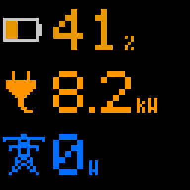

- Draws everything itself in pure Python (pixel fonts; no Pillow needed).
- Uses **any [Material Design Icon](https://pictogrammers.com/library/mdi/)**, like Home Assistant (`mdi:transmission-tower`). Icons aren't stored here: the official `@mdi/js` package is downloaded once from jsDelivr, cached, and each icon is converted to pixels on the fly, with smoothed edges.
- Sends frames to WLED over **DDP** (UDP 4048), so WLED shows them as live data. If the app stops, WLED goes back to its own effect or preset after its realtime timeout.
- **Rows or a grid:** up to three big rows, or a grid with any number of rows and columns (cells can span), each cell sizing its icon and font to fit.
- Colours and icons can follow the value (thresholds), e.g. a battery icon and colour by charge level.
- Several matrices, each with its own screens and dwell time (a screen can set its own); an optional on/off entity per matrix.
- **Camera screens:** a Home Assistant camera's still, refreshed every `refresh` seconds while the screen is shown (needs Pillow).
- Any Home Assistant entity with a numeric state can be shown, and on/off entities (switches, lights, binary sensors) as `on`/`off`.
- **Aircraft screens:** live aircraft near home from your own ADS-B receiver (readsb / tar1090 `aircraft.json`, or a Home Assistant entity listing them): a **radar**, the **nearest aircraft**, a **departures board**, or a flashing **alert** for low flyers, helicopters and emergencies.
- **Power-flow screen:** solar, grid, battery, car and house joined by lines, with small comets moving the way the power flows, faster with more power (Victron or any other system with power sensors).
- **Weather screen:** today and tomorrow side by side from any Home Assistant weather entity: animated icons, the high and low coloured by temperature, rain and wind with an arrow.
- **Tide screen:** the next high and low waters as a table, or today's tide curve, from any entity listing them (e.g. the UKHO Tides integration for UK ports).
- **Conditional and priority screens:** show a screen only while an entity is on, or let it interrupt the rotation (e.g. an alert).
- **Animation:** a screen can set its own `frame_rate`, redrawn faster only while it's showing.
- **Live view in a browser:** mirror what a matrix shows, or preview any screen at up to 30 frames a second, from AppDaemon's web server.
- **Stars screen:** weekly star points for children, with a WELL DONE pop-up when a star is earned.
- **Network screen:** internet speed in big digits with the line in use and latency, and a failover alert.
- **Night dimming:** dim every screen (and stop flashing and fast animation) between two times.

## Install

**HACS (custom repository):** HACS → ⋮ → Custom repositories → add this repository with category **AppDaemon**, then download "WLED Matrix". HACS needs AppDaemon apps enabled in its settings.

**Manual:** copy `apps/wled_matrix/` into your AppDaemon `apps` folder.

Then add a config to your `apps.yaml` (see below, and [`examples/apps.yaml`](examples/apps.yaml)). Each screen type below shows an example; its full options are in [`docs/screens/`](docs/screens/).

**Restart AppDaemon after installing or updating the app.** AppDaemon only scans for new app folders at start-up, and it reloads `wled_matrix.py` but not its helper modules (the `wm/` package), so an update can leave them out of step until a restart. Changes to your `apps.yaml` reload by themselves.

**Home Assistant OS, AppDaemon app 0.15 or later:** AppDaemon reads apps from its own folder, not from `/config/appdaemon/apps` where HACS installs them. Point it there with `app_dir: /homeassistant/appdaemon/apps` in `appdaemon.yaml`, e.g. with the app's `init_commands` option:

```yaml
init_commands:
  - mkdir -p /homeassistant/appdaemon/apps
  - "grep -q '^  app_dir:' /config/appdaemon.yaml || sed -i 's|^appdaemon:|appdaemon:\\n  app_dir: /homeassistant/appdaemon/apps|' /config/appdaemon.yaml"
```

## Configuration

```yaml
wled_matrix:
  module: wled_matrix
  class: WledMatrix
  refresh: 1                  # seconds between frames; keep below WLED's ~2.5 s realtime timeout
  # icon_cache: /config/wled_matrix_cache   # where the downloaded icon set is cached (default shown)
  matrices:
    - host: 192.168.1.50      # WLED device
      width: 64
      height: 64
      dwell: 10               # seconds per screen when there's more than one
      screens: [energy]
      enabled_entity: input_boolean.kitchen_matrix   # optional: only draw while this is on
  screens:
    energy:
      rows:
        - icon: mdi:battery
          icon_thresholds:          # pick the icon by value, like HA's battery icons
            - {above: 90, icon: mdi:battery}
            - {above: 70, icon: mdi:battery-80}
            - {above: 50, icon: mdi:battery-60}
            - {above: 30, icon: mdi:battery-40}
            - {above: 10, icon: mdi:battery-20}
            - {above: 0, icon: mdi:battery-outline}
          entity: sensor.battery_state_of_charge
          format: percent
          thresholds:
            - {above: 50, colour: [0, 190, 0]}
            - {above: 25, colour: [230, 150, 0]}
          colour: [230, 0, 0]
        - icon: mdi:power-plug
          entity: sensor.house_load_power
          format: power
          colour: [255, 150, 0]
        - icon: mdi:transmission-tower
          entity: sensor.grid_power
          format: power
          thresholds:
            - {above: 50, colour: [230, 0, 0]}
          colour: [0, 110, 255]
```

### On/off screens

```yaml
    heating:
      rows:
        - icon: mdi:water-boiler
          entity: switch.immersion
          format: onoff
          thresholds: [{above: 1, colour: [230, 40, 0]}]   # coloured when on
          colour: [70, 70, 70]                              # grey when off
```

### Grid screens

For more than three items, or items side by side, give a screen a `grid` and a list of `cells`. Each cell takes the same options as a row, plus its position:

```yaml
  screens:
    overview:
      grid: {rows: 4, columns: 2}
      cells:
        - {row: 0, col: 0, icon: mdi:battery-40, entity: sensor.battery_soc, format: percent}
        - {row: 0, col: 1, icon: mdi:thermometer, entity: sensor.outside_temperature, format: decimal1, unit: C}
        - {row: 1, col: 0, colspan: 2, icon: mdi:power-plug, entity: sensor.house_load_power, format: power}
        - {row: 2, col: 0, icon: mdi:transmission-tower, entity: sensor.grid_power, format: power}
        - {row: 2, col: 1, icon: mdi:solar-power, entity: sensor.pv_power, format: power}
```

A cell without an `entity` (or with `show_value: false`) shows just its icon, centred: handy as a label for the cells next to it (e.g. a `mdi:cable-data` cell spanning two rows beside download and upload rates).

Each cell sizes itself: the icon follows the cell height (up to 24 px), and the number uses big digits when they fit, otherwise the small font. The unit is left out if there's no room. `rowspan` and `colspan` merge cells. Screens with `rows` (as above) are a one-column grid.

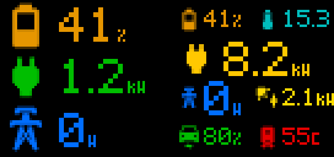

[Config docs](docs/screens/rows-and-grids.md): every option for this screen.

### Camera screens

A screen with `camera:` shows that camera's current still, scaled to the matrix and refreshed every `refresh` seconds while it's on display (nothing is fetched while other screens show). The still comes from Home Assistant's camera proxy, which scales it down first; matrices showing the same camera share one fetch, and if a fetch fails the last good frame stays up.

```yaml
  screens:
    drive:
      camera: camera.drive          # any camera entity
      dwell: 15                     # optional: this screen's time in the rotation (overrides the matrix's dwell)
      fit: crop                     # crop (fill, cut the sides of a wide picture; default) or letterbox
      # autocontrast: true          # default: stretch the levels; makes dim and night-time infrared pictures readable
      # brightness: 1.0             # 1.0 = unchanged
      # contrast: 1.0
      # gamma: 1.0                  # above 1 darkens the mid-tones
```

Camera screens need **Pillow**: on Home Assistant OS, add `Pillow` to the AppDaemon app's `python_packages` option and restart it. The app reaches Home Assistant through the Supervisor (no token needed); elsewhere, set `ha_url` and `ha_token` (a long-lived access token) on the app.

[Config docs](docs/screens/camera.md): every option for this screen.

### Aircraft screens

A screen with `aircraft:` shows the aircraft around a home point, from your own ADS-B receiver, refreshed every `refresh` seconds.

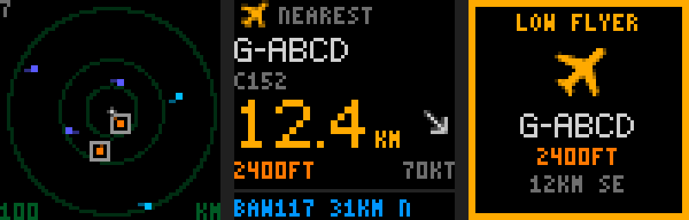

```yaml
  screens:
    planes:
      aircraft:
        style: radar                 # radar, nearest, board or alert
        url: http://192.168.1.20/tar1090/data/aircraft.json   # readsb / tar1090 / dump1090-fa
        # headers: {Host: adsb.example.lan}                  # optional extra HTTP headers
        latitude: 51.5007            # home point; default: Home Assistant's zone.home
        longitude: -0.1246
        range_km: 100                # radar: distance to the edge of the panel
        # marker: arrow              # radar: arrow (default), line or tick; arrows turn to lines above line_above (12)
        # coastline: /config/coastline.geojson   # radar: coast outline to scale (see below)
```

[Config docs](docs/screens/aircraft.md): every option for this screen.

### Power-flow screen

A screen with `power_flow:` shows where the power is going right now: the sun and solar power top left, the grid top right, the battery (filled and coloured by charge) bottom left, the car bottom right, and the house in the middle. Small comets (a bright head with a 3-pixel fading tail, so the direction shows even in a still frame) move along each dim line in the direction of flow, faster with more power. Numbers are kW with one decimal; a small `KW` under the house figure gives the unit once for all of them.

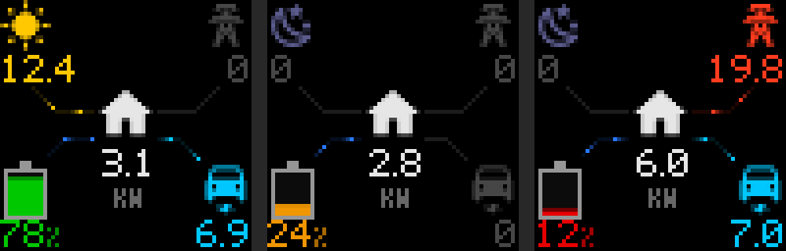

```yaml
  screens:
    power_flow:
      frame_rate: 5                 # redraw 5 times a second while showing, so the comets move smoothly (see below)
      power_flow:
        solar: [sensor.pv_dc_power, sensor.pv_ac_power]   # one entity or a list, added up
        grid: sensor.grid_power     # W, + = importing, - = exporting
        battery: sensor.battery_power        # W, + = charging, - = discharging
        soc: sensor.battery_state_of_charge  # %
        load: sensor.house_load_power        # W
        ev: sensor.ev_charger_power          # W
        load_includes_ev: true      # the load sensor already counts the car: show the house as load - car
        max_kw: 10                  # comets reach full speed at this power
        # night_speed: 1             # comets' pixels a second during the night window
```

[Config docs](docs/screens/power-flow.md): every option for this screen.

### Weather screen

A screen with `weather:` shows today and tomorrow side by side: the day (today underlined), an animated icon (sun rays twinkle, rain falls, mist drifts), the high in big digits and the low, coloured on a Met Office-like scale (purple below −5 °C, blue at 0, teal at 5, green at 10, yellow at 15, orange at 20, red from 25), then the rain and the wind with an arrow pointing the way it blows. Rain and wind units are printed once, between the two days.

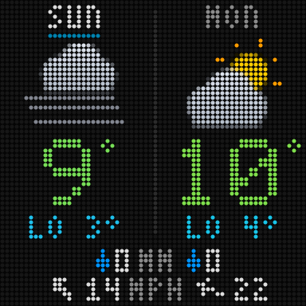

```yaml
  screens:
    weather:
      frame_rate: 4                 # redraw 4 times a second while showing, for the animation
      dwell: 15
      weather:
        weather: weather.home       # any HA weather entity with a daily forecast
        wind_unit: mph              # mph | kmh | ms | kn
```

[Config docs](docs/screens/weather.md): every option for this screen.

### Tide screen

A screen with `tides:` shows high (▲) and low (▼) waters from an entity that lists them, with heights in metres (a small `M` in the top-right corner gives the unit once). Two layouts:

- `list` (default): the next four, time in large digits and height, `IN 2H06` under the next one, and a line with the day's name before the first of another day's.
- `curve`: today from 00:00 to 24:00 with the sea filled in, a dotted line and a dot for now and the past dimmed, with the next high and low below. Between high and low the curve is a half-cosine (within a few centimetres of the real tide on most UK coasts).

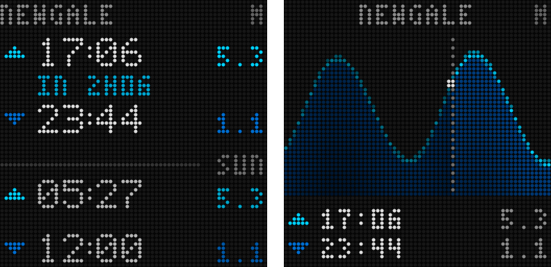

```yaml
  screens:
    tides:
      tides:
        tides: sensor.solva_tide    # the entity with the list of tides
        attribute: predictions      # the attribute holding it
        label: NEWGALE              # shown top left (or centred over the curve)
        layout: list                # list | curve
```

[Config docs](docs/screens/tides.md): every option for this screen.

### Network screen

Internet speed and the line in use, drawn pixel by pixel. List the main line first and the backup second.

```yaml
internet_big:
  network:
    style: big                    # big = large download figure; alert = failover interrupt (below)
    unit_label: MBIT/S            # shown once; speeds are in the entities' unit
    backup_active: binary_sensor.internet_on_starlink   # on while the backup line carries the traffic
    links:
      - name: FTTP
        icon: mdi:cable-data
        down: sensor.router_wan1_rx
        up: sensor.router_wan1_tx
        latency: sensor.router_wan1_latency
        max_down: 1800            # line speed, for the fill bar along the bottom
      - name: STARLINK
        icon: mdi:satellite-variant
        down: sensor.router_wan2_rx
        up: sensor.router_wan2_tx
        latency: sensor.router_wan2_latency
internet_alert:                   # shows only during a failover, for up to 60 s
  priority: true
  show_if: binary_sensor.internet_on_starlink
  max_time: 60
  network: {style: alert, backup_active: binary_sensor.internet_on_starlink, links: [...same as above...]}
```

[Config docs](docs/screens/network.md): every option for this screen.

### Stars screen

Weekly star points for children: each child's stars this week (gold when earned, dim when not) and a yearly total,
plus a pop-up when a star is added or taken away. Keep the counts in Home Assistant counters (e.g. a weekly counter
with maximum 7 and a yearly one), and set the `alert` text (`child,+` or `child,-`) and an on/off helper from the
script that changes them.

```yaml
stars:
  stars:
    style: week
    most: 7                       # stars per week
    kids:
      - {id: seth, name: Seth, colour: [0, 170, 255], week: counter.seth_stars_week, year: counter.seth_stars_year}
      - {id: dylan, name: Dylan, colour: [0, 220, 90], week: counter.dylan_stars_week, year: counter.dylan_stars_year}
stars_alert:
  priority: true
  show_if: input_boolean.stars_alert_showing
  max_time: 20
  restart_on: [input_text.stars_alert, counter.seth_stars_week, counter.dylan_stars_week]   # each press shows it again
  frame_rate: 3                   # twinkles (still at night)
  stars: {style: alert, alert: input_text.stars_alert, kids: [...same as above...]}
```

[Config docs](docs/screens/stars.md): every option for this screen.

### Aquarium screen

An animated fish tank: fish swim across at different depths, weed sways, bubbles rise and light ripples at the
surface. It needs no entities. Every time a fish swims in it gets a random shape, colours, side, speed, depth and
drift. At night it's drawn still.

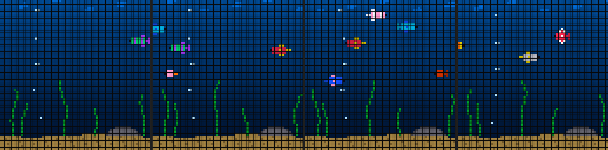

```yaml
    aquarium:
      aquarium:
        fish: 7          # optional, default 7
        seed: 0          # optional: a different number gives a different sequence of fish
      frame_rate: 5
      dwell: 15
```

[Config docs](docs/screens/aquarium.md): every option for this screen.

### Jungle screen

An animated jungle: monkeys swing from vine to vine and one climbs a tree, a banded snake slides along a bough,
parrots and toucans fly through and butterflies wander low. It needs no entities. Every time an animal comes in it
gets a random look, side, speed and path. At night it's drawn still.

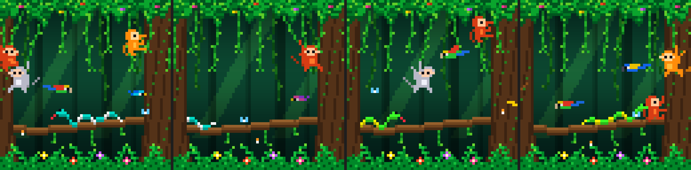

```yaml
    jungle:
      jungle:
        monkeys: 2       # optional, default 2 swinging monkeys (plus the climber)
        birds: 3         # optional, default 3
        butterflies: 2   # optional, default 2
        seed: 0          # optional: a different number gives a different sequence of animals
      frame_rate: 5
      dwell: 15
```

[Config docs](docs/screens/jungle.md): every option for this screen.

### Platformer screen

An auto-playing early-90s-style platform game: Rusty the fox runs through stages built from the seed, jumping gaps, bouncing on slimes and collecting gems and stars, with a score, a progress bar to the flag and a backdrop that changes from meadow to sunset, moonlight and snow. It needs no entities. At night it's drawn still.

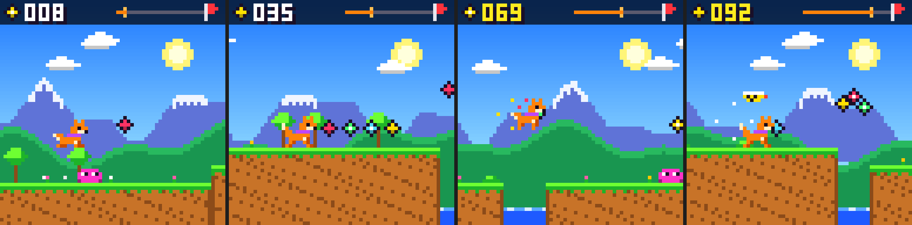

```yaml
    platformer:
      platformer:
        seed: 0          # optional: a different number gives a different run
      frame_rate: 5
      dwell: 15
```

[Config docs](docs/screens/platformer.md): every option for this screen.

### Blocks screen

An auto-playing falling-block puzzle: four-square shapes fall into a well, a deliberately imperfect player turns and drops them, full rows flash and disappear, and a new game starts when the stack gets high. Shows the next shape, rows cleared and score. It needs no entities. At night it's drawn still.

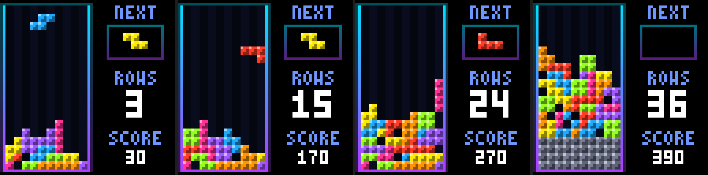

```yaml
    blocks:
      blocks:
        seed: 0          # optional: a different number gives a different run
      frame_rate: 5
      dwell: 15
```

[Config docs](docs/screens/blocks.md): every option for this screen.

### Surf screen

A surfer riding a breaking wave, seen side-on: paddling in, popping up, carving up and down the face, then a kick-out or a wipeout. It needs no entities. At night it's drawn still.

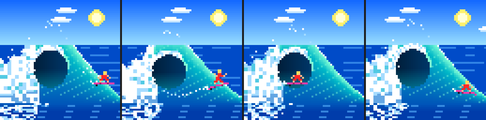

The three wave styles (barrel, rolling, storm):

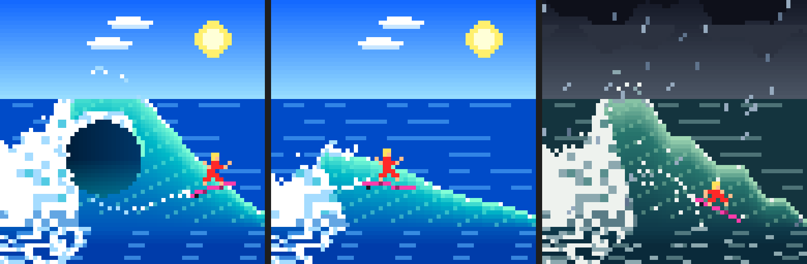

```yaml
    surf:
      surf:
        wave_style: barrel   # barrel (default), rolling or storm
        wave_size: 1.0       # 0.6 to 1.4
        sky: auto            # auto, day, sunset, night or storm (time_of_day also works)
        surfer: auto         # auto, sandy, dark, red or silver
        wetsuit: auto        # auto, a colour name, "#rrggbb" or [r, g, b]
        board: auto          # as wetsuit
        wipeouts: 0.35       # share of rides ending in a wipeout (0.6 for storm)
        ride_seconds: 22     # length of one ride (minimum 12)
        seed: 0
      frame_rate: 5
      dwell: 15
```

[Config docs](docs/screens/surf.md): every option for this screen.

### Quest screen

An auto-playing top-down adventure: Pip the lantern-mage crosses one-screen rooms (meadow, shore, vault), zaps crabs, bats, wisps and beetles with a staff, picks up coins, gems, potions and keys, and the screen scrolls to the next room. Shows energy crystals, the key and coins. It needs no entities. At night it's drawn still.

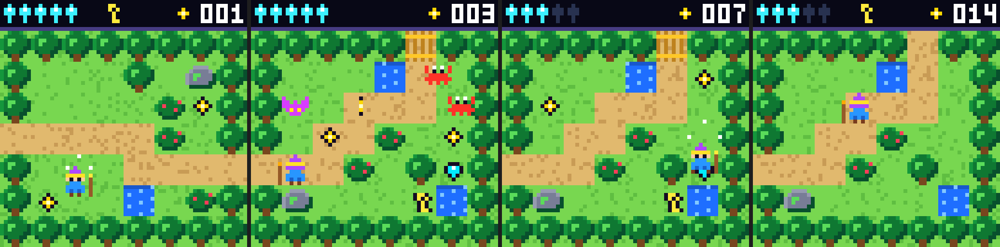

```yaml
    quest:
      quest:
        seed: 0          # optional: a different number gives a different run
      frame_rate: 5
      dwell: 15
```

[Config docs](docs/screens/quest.md): every option for this screen.

### Kart screen

An auto-playing kart race on a tilted track running to the horizon: six animal drivers race three laps of a circuit built from the seed, with striped kerbs, trees, spark crystals, countdown lights and a finishing panel. Shows position and lap. It needs no entities. At night it's drawn still.

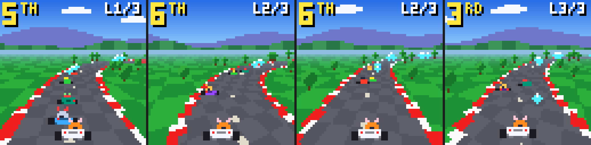

```yaml
    kart:
      kart:
        seed: 0          # optional: a different number gives a different run
      frame_rate: 5
      dwell: 15
```

[Config docs](docs/screens/kart.md): every option for this screen.

### Duel screen

Two contenders, red and blue, battle with padded sticks on podiums in a lit TV-studio arena (spotlights, crowd, camera flashes) until one falls onto the crash mat and the winner celebrates; a scoreboard counts bouts. It needs no entities. At night it's drawn still.

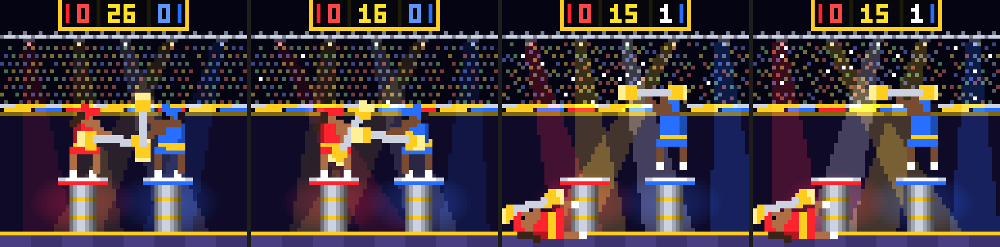

```yaml
    duel:
      duel:
        seed: 0          # optional: a different number gives a different run
      frame_rate: 5
      dwell: 15
```

[Config docs](docs/screens/duel.md): every option for this screen.

### Conditional and priority screens

Any screen can take:

| Key | Meaning |
|---|---|
| `show_if` | An entity: the screen is only in the rotation while it's `on` |
| `priority` | `true`: the screen isn't in the normal rotation; while its `show_if` entity is on it **interrupts** the rotation, for at most `max_time` seconds (default 60), and then only again after the entity has gone off and on, or a `restart_on` entity changes. When several are on, the first in the matrix's `screens` list wins |
| `max_time` | Seconds a priority screen stays up at most |

For example, a radar in the rotation, and an alert that jumps in when something interesting is near:

```yaml
  matrices:
    - host: 192.168.1.50
      screens: [energy, radar, plane_alert]
  screens:
    radar:
      aircraft: {style: radar, entity: sensor.adsb_radar}
    plane_alert:
      priority: true
      show_if: binary_sensor.adsb_interesting
      max_time: 60
      aircraft: {style: alert, entity: sensor.adsb_radar}
```

### Random values

Any whole-number option can be drawn at random instead of fixed: write `{random: [low, high]}` and a new number from
`low` to `high` (inclusive) is picked every time the screen comes up on a matrix. It works for a screen's own options
and for the generic ones like `dwell`:

```yaml
  screens:
    aquarium:
      aquarium:
        fish: {random: [1, 10]}      # a different shoal each visit
        seed: {random: [0, 9999]}    # and a different sequence of fish
      frame_rate: 5
      dwell: {random: [10, 20]}      # stays up 10 to 20 seconds
```

Both numbers must be whole; anything else stops the app at start-up with the screen and option named. A screen listed
on several matrices is one screen, so a new draw when one matrix switches to it also applies to the others.

### Live view in a browser

Set `web: true` and the app adds a page to AppDaemon's own web server: `http://<appdaemon host>:5050/app/matrix`.

- **Mirror:** pick a matrix and see exactly the frames being sent to it (about 1 a second, or the screen's
  `frame_rate`), with the screen name and how long ago the frame was sent.
- **Preview:** pick any screen, even one not in a rotation, and it's drawn on demand from live Home Assistant states,
  at 5 to 30 frames a second, by day or (tick Night) dimmed as at night. Handy for designing screens away from the
  panels.
- LED-dot or square look; the page remembers your choices.

Give each matrix a `name:` (e.g. `Kitchen`) to show it in the list instead of its address. There's no login:
AppDaemon's web server is local, and the page only reads. `/app/matrix_info` (JSON) and `/app/matrix_frame` (raw RGB
bytes) are what the page uses.

### Night dimming

```yaml
wled_matrix:
  night:
    start: "22:00"
    end: "07:00"
    brightness: 0.25     # every pixel scaled to 25 %; flashing and fast animation stop
    # time_zone: Europe/London   # default: Home Assistant's time zone
```

## Updating

Update through HACS (or copy the new files), then **restart AppDaemon** so all the app's modules reload together.

## Troubleshooting

- **Nothing on the matrix:** check AppDaemon's log for `wled_matrix` lines (on HAOS: Settings → Apps → AppDaemon → Log). It should say `Driving N matrix(es)`.
- **Is WLED receiving?** Open `http://<wled-host>/json/info`: `"live": true` and `"lm": "DDP"` mean frames are arriving, and `"lip"` shows from where.
- **An icon is missing:** check the name at [pictogrammers.com/library/mdi](https://pictogrammers.com/library/mdi/) and use it as `mdi:<name>`. Unknown names draw no icon.
- **A value shows `-`:** the entity is unavailable or its state isn't a number.

## Notes

- WLED needs "Receive UDP realtime" on (the default).
- The first use of MDI icons downloads `@mdi/js` (about 2.8 MB, MDI 7.4.47, Apache 2.0) from cdn.jsdelivr.net, so AppDaemon needs internet access once. After that the cached copy is used.
- One 64×64 frame is 12 KB, sent as 9 UDP packets; a refresh of 1 s is light on the network.

## Licence

MIT
