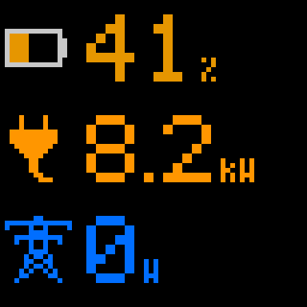
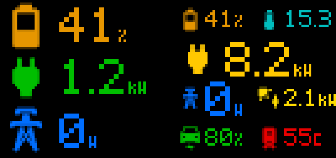

# WLED Matrix

An [AppDaemon](https://appdaemon.readthedocs.io/) app that shows Home Assistant values on **WLED LED matrices** (e.g. the 64×64 [Apollo M-1](https://apolloautomation.com/)) as simple screens of **icon + number + unit** items, laid out in rows or a grid, with screens on rotation.



- Draws everything itself in pure Python (pixel fonts; no Pillow needed).
- Uses **any [Material Design Icon](https://pictogrammers.com/library/mdi/)**, like Home Assistant (`mdi:transmission-tower`). Icons aren't stored here: the official `@mdi/js` package is downloaded once from jsDelivr, cached, and each icon is converted to pixels on the fly, with smoothed edges.
- Sends frames to WLED over **DDP** (UDP 4048), so WLED shows them as live data. If the app stops, WLED goes back to its own effect or preset after its realtime timeout.
- **Rows or a grid:** up to three big rows, or a grid with any number of rows and columns (cells can span), each cell sizing its icon and font to fit.
- Colours and icons can follow the value (thresholds), e.g. a battery icon and colour by charge level.
- Several matrices, each with its own screens and dwell time; an optional on/off entity per matrix.
- Any Home Assistant entity with a numeric state can be shown, and on/off entities (switches, lights, binary sensors) as `on`/`off`.

## Install

**HACS (custom repository):** HACS → ⋮ → Custom repositories → add this repository with category **AppDaemon**, then download "WLED Matrix". HACS needs AppDaemon apps enabled in its settings.

**Manual:** copy `apps/wled_matrix/` into your AppDaemon `apps` folder.

Then add a config to your `apps.yaml` (see below, and [`examples/apps.yaml`](examples/apps.yaml)).

**Restart AppDaemon after installing or updating the app.** AppDaemon only scans for new app folders at start-up, and it reloads `wled_matrix.py` but not its helper modules (`wm_*.py`), so an update can leave them out of step until a restart. Changes to your `apps.yaml` reload by themselves.

**Home Assistant OS, AppDaemon app 0.15 or later:** AppDaemon reads apps from its own folder, not from `/config/appdaemon/apps` where HACS installs them. Point it there with `app_dir: /homeassistant/appdaemon/apps` in `appdaemon.yaml`, e.g. with the app's `init_commands` option:

```yaml
init_commands:
  - mkdir -p /homeassistant/appdaemon/apps
  - "grep -q '^  app_dir:' /config/appdaemon.yaml || sed -i 's|^appdaemon:|appdaemon:\\n  app_dir: /homeassistant/appdaemon/apps|' /config/appdaemon.yaml"
```

## Configuration

```yaml
wled_matrix:
  module: wled_matrix
  class: WledMatrix
  refresh: 1                  # seconds between frames; keep below WLED's ~2.5 s realtime timeout
  # icon_cache: /config/wled_matrix_cache   # where the downloaded icon set is cached (default shown)
  matrices:
    - host: 192.168.1.50      # WLED device
      width: 64
      height: 64
      dwell: 10               # seconds per screen when there's more than one
      screens: [energy]
      enabled_entity: input_boolean.kitchen_matrix   # optional: only draw while this is on
  screens:
    energy:
      rows:
        - icon: mdi:battery
          icon_thresholds:          # pick the icon by value, like HA's battery icons
            - {above: 90, icon: mdi:battery}
            - {above: 70, icon: mdi:battery-80}
            - {above: 50, icon: mdi:battery-60}
            - {above: 30, icon: mdi:battery-40}
            - {above: 10, icon: mdi:battery-20}
            - {above: 0, icon: mdi:battery-outline}
          entity: sensor.battery_state_of_charge
          format: percent
          thresholds:
            - {above: 50, colour: [0, 190, 0]}
            - {above: 25, colour: [230, 150, 0]}
          colour: [230, 0, 0]
        - icon: mdi:power-plug
          entity: sensor.house_load_power
          format: power
          colour: [255, 150, 0]
        - icon: mdi:transmission-tower
          entity: sensor.grid_power
          format: power
          thresholds:
            - {above: 50, colour: [230, 0, 0]}
          colour: [0, 110, 255]
```

### On/off screens

```yaml
    heating:
      rows:
        - icon: mdi:water-boiler
          entity: switch.immersion
          format: onoff
          thresholds: [{above: 1, colour: [230, 40, 0]}]   # coloured when on
          colour: [70, 70, 70]                              # grey when off
```

### Grid screens

For more than three items, or items side by side, give a screen a `grid` and a list of `cells`. Each cell takes the same options as a row, plus its position:

```yaml
  screens:
    overview:
      grid: {rows: 4, columns: 2}
      cells:
        - {row: 0, col: 0, icon: mdi:battery-40, entity: sensor.battery_soc, format: percent}
        - {row: 0, col: 1, icon: mdi:thermometer, entity: sensor.outside_temperature, format: decimal1, unit: C}
        - {row: 1, col: 0, colspan: 2, icon: mdi:power-plug, entity: sensor.house_load_power, format: power}
        - {row: 2, col: 0, icon: mdi:transmission-tower, entity: sensor.grid_power, format: power}
        - {row: 2, col: 1, icon: mdi:solar-power, entity: sensor.pv_power, format: power}
```

A cell without an `entity` (or with `show_value: false`) shows just its icon, centred: handy as a label for the cells next to it (e.g. a `mdi:cable-data` cell spanning two rows beside download and upload rates).

Each cell sizes itself: the icon follows the cell height (up to 24 px), and the number uses big digits when they fit, otherwise the small font. The unit is left out if there's no room. `rowspan` and `colspan` merge cells. Screens with `rows` (as above) are a one-column grid.



Row / cell options:

| Key | Meaning |
|---|---|
| `icon` | `none` for no icon, any Material Design Icon as `mdi:<name>`, or a built-in pixel icon: `battery`, `plug`, `pylon`, `sun`, `thermometer` (these work offline) |
| `icon_thresholds` | List of `{above, icon}`, checked top to bottom; the first one the value reaches wins (else `icon`) |
| `show_value` | `false` shows only the icon, centred and coloured by `thresholds` (e.g. a switch's status icon) |
| `icon_size` | MDI icon size in pixels (default: the cell height, max 24) |
| `row`, `col`, `rowspan`, `colspan` | Grid screens only: the cell's position and size (from 0) |
| `entity` | Leave out for an icon-only cell. Any entity with a numeric state, or an on/off state with `format: onoff`. Unavailable or unknown shows `-` |
| `format` | `percent` (0–100, `%`), `power` (W, or kW from 1000 W), `number` (rounded), `decimal1` / `decimal2` (that many decimals), `mbps` (Mbit/s in: `M` with one decimal below 10, whole numbers to 999, then `G` in Gbit/s), `onoff` (shows `on`/`off` for switches, lights and binary sensors; on counts as 1 and off as 0 for `thresholds`) |
| `unit` | Override the unit text (characters available: `% W k C ° h M G`) |
| `colour` | `[r, g, b]` default colour |
| `thresholds` | List of `{above, colour}`, checked top to bottom; the first one the value reaches wins, so list the highest first |
| `fill`, `fill_max` | Built-in icons only: fill the icon's fill area in proportion to the value (default max 100) |
| `icon_colour` | Draw the icon outline in a fixed colour instead of the row colour |

## Updating

Update through HACS (or copy the new files), then **restart AppDaemon** so all the app's modules reload together.

## Troubleshooting

- **Nothing on the matrix:** check AppDaemon's log for `wled_matrix` lines (on HAOS: Settings → Apps → AppDaemon → Log). It should say `Driving N matrix(es)`.
- **Is WLED receiving?** Open `http://<wled-host>/json/info`: `"live": true` and `"lm": "DDP"` mean frames are arriving, and `"lip"` shows from where.
- **An icon is missing:** check the name at [pictogrammers.com/library/mdi](https://pictogrammers.com/library/mdi/) and use it as `mdi:<name>`. Unknown names draw no icon.
- **A value shows `-`:** the entity is unavailable or its state isn't a number.

## Notes

- WLED needs "Receive UDP realtime" on (the default).
- The first use of MDI icons downloads `@mdi/js` (about 2.8 MB, MDI 7.4.47, Apache 2.0) from cdn.jsdelivr.net, so AppDaemon needs internet access once. After that the cached copy is used.
- One 64×64 frame is 12 KB, sent as 9 UDP packets; a refresh of 1 s is light on the network.

## Licence

MIT
