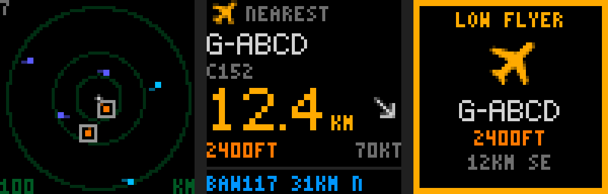

# Aircraft screens

A screen with `aircraft:` shows the aircraft around a home point, from your own ADS-B receiver, refreshed every `refresh` seconds.



```yaml
  screens:
    planes:
      aircraft:
        style: radar                 # radar, nearest, board or alert
        url: http://192.168.1.20/tar1090/data/aircraft.json   # readsb / tar1090 / dump1090-fa
        # headers: {Host: adsb.example.lan}                  # optional extra HTTP headers
        latitude: 51.5007            # home point; default: Home Assistant's zone.home
        longitude: -0.1246
        range_km: 100                # radar: distance to the edge of the panel
        # marker: arrow              # radar: arrow (default), line or tick; arrows turn to lines above line_above (12)
        # coastline: /config/coastline.geojson   # radar: coast outline to scale (see below)
```

| Style | What it shows |
|---|---|
| `radar` | North up, home a white dot in the middle, rings (default at a quarter, half and all of `range_km`), each aircraft a small arrow **coloured by height** pointing the way it's flying (see `marker`); "interesting" aircraft get a box round them. The count in the top corner, the range at the bottom |
| `nearest` | The closest aircraft: callsign, type (or a word like `HELICOPTER`) and route if known, distance in big digits with an arrow pointing to it, height and speed. The bottom line shows the next aircraft, one at a time (`page_seconds`, default 3) |
| `board` | The four nearest, two lines each: callsign and route (or type), then distance, direction and height |
| `alert` | A full-screen card with a flashing border for the most urgent **interesting** aircraft: the reason (`LOW FLYER`, `HELICOPTER`, `EMERGENCY`, `OVERHEAD`…), an aeroplane or helicopter icon, callsign, height, distance and direction. Shows `nearest` if nothing is interesting |

**Data source** (one of):
- `url`: an `aircraft.json` from readsb, tar1090 or dump1090-fa (read at most once a second, shared by all matrices). readsb-protobuf's own web page serves protobuf only; put tar1090 in front of it.
- `entity` (and optionally `attribute`, default `aircraft`): a Home Assistant entity whose attribute is a list of readsb-style items (`hex`, `flight`, `lat`, `lon`, `alt_baro`, `track`, `gs`, `category`, `squawk`), optionally with `interesting` (a reason, or null), `route` (e.g. `LHR>JFK`) and `type` (e.g. `A320`). Use this when another app already reads your receiver and decides what's interesting, so the matrix and your dashboards agree.

**"Interesting"**: an item's own `interesting` value if the source gives one; otherwise these rules (change them with `alert_rules`, or `alert_rules: false` to turn them off): squawk 7500/7600/7700 or a helicopter within `special_km` (50), below `low_ft` (5,000 ft) within `low_km` (20 km), or within `overhead_km` (5 km).

| Option | Default | Meaning |
|---|---|---|
| `range_km` | 100 | Radar: distance from home to the edge |
| `rings_km` | quarter, half, full range | Radar rings |
| `coastline` | none | Radar: a GeoJSON file of coastlines (or any lines: LineString, MultiLineString, Polygon outlines, lon/lat) drawn to scale round home, so you can see where the aircraft are. E.g. clip [Natural Earth](https://www.naturalearthdata.com/)'s public-domain 1:10m coastline to your area; the file is read once |
| `marker` | `arrow` | Radar: how each aircraft is drawn. `arrow`: a 5 × 5 arrowhead (bright head, dimmer shaft) snapped to the nearest of 8 headings. `line`: 5 pixels along the exact track, white nose, full-colour body and a fading tail; smaller, so better in a busy sky. `tick`: the old 2 × 2 dot with two dim pixels ahead. Aircraft with no track are a 2 × 2 dot |
| `line_above` | 12 | Radar: with `marker: arrow`, switch to `line` while more than this many aircraft are on the radar, so a crowded sky stays readable. `0` turns this off |
| `show_count`, `show_range` | true | Radar: the aircraft count and the range label |
| `max_age` | 15 | Ignore aircraft whose last position is older than this (seconds) |
| `page_seconds`, `ticker_count` | 3, 5 | Nearest: how long each other aircraft shows on the bottom line, and how many |
| `flash` | true | Alert: flash the border once a second (never at night, see below) |
| `altitude_colours` | orange < 5,000 ft, green < 20,000 ft, cyan < 33,000 ft, blue above | List of `{below: <feet>, colour: [r, g, b]}`, the last without `below` |
| `colours` | | Override any of `ring`, `house`, `text`, `label`, `accent` (alert and highlights), `ticker`, `ground`, `marker`, `coast` |

The box round an "interesting" aircraft is 7 × 7, drawn before the aircraft itself, so the arrow or line is never hidden under it.

Tests: `python3 -m unittest discover tests` (plain Python, no Home Assistant needed).

Positions update once a second (the receiver's rate), so dots and numbers move at the frame rate; there's no animation between frames.

Back to the [README](../../README.md#configuration).
