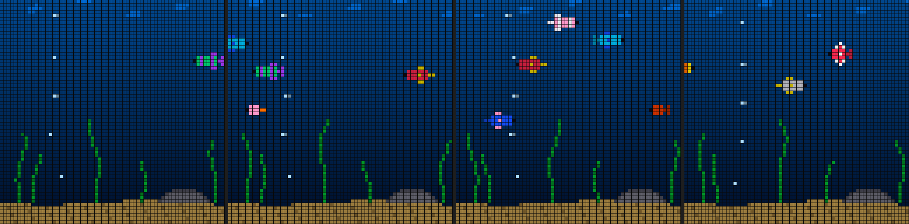

# Aquarium screen

An animated fish tank: fish swim across at different depths, weed sways, bubbles rise and light ripples at the
surface. It needs no entities. Every time a fish swims in it gets a random shape, colours, side, speed, depth and
drift. At night it's drawn still.



```yaml
    aquarium:
      aquarium:
        fish: 7          # optional, default 7
        seed: 0          # optional: a different number gives a different sequence of fish
      frame_rate: 5
      dwell: 15
```

Back to the [README](../../README.md#configuration).
