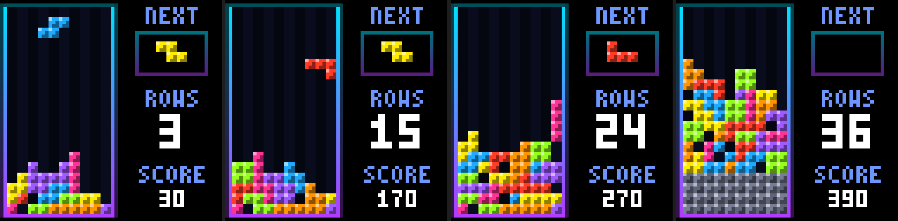

# Blocks screen

An auto-playing falling-block puzzle: four-square shapes fall into a well, a deliberately imperfect player turns and drops them, full rows flash and disappear, and a new game starts when the stack gets high. Shows the next shape, rows cleared and score. It needs no entities. At night it's drawn still.



```yaml
    blocks:
      blocks:
        seed: 0          # optional: a different number gives a different run
      frame_rate: 5
      dwell: 15
```

Back to the [README](../../README.md#configuration).
