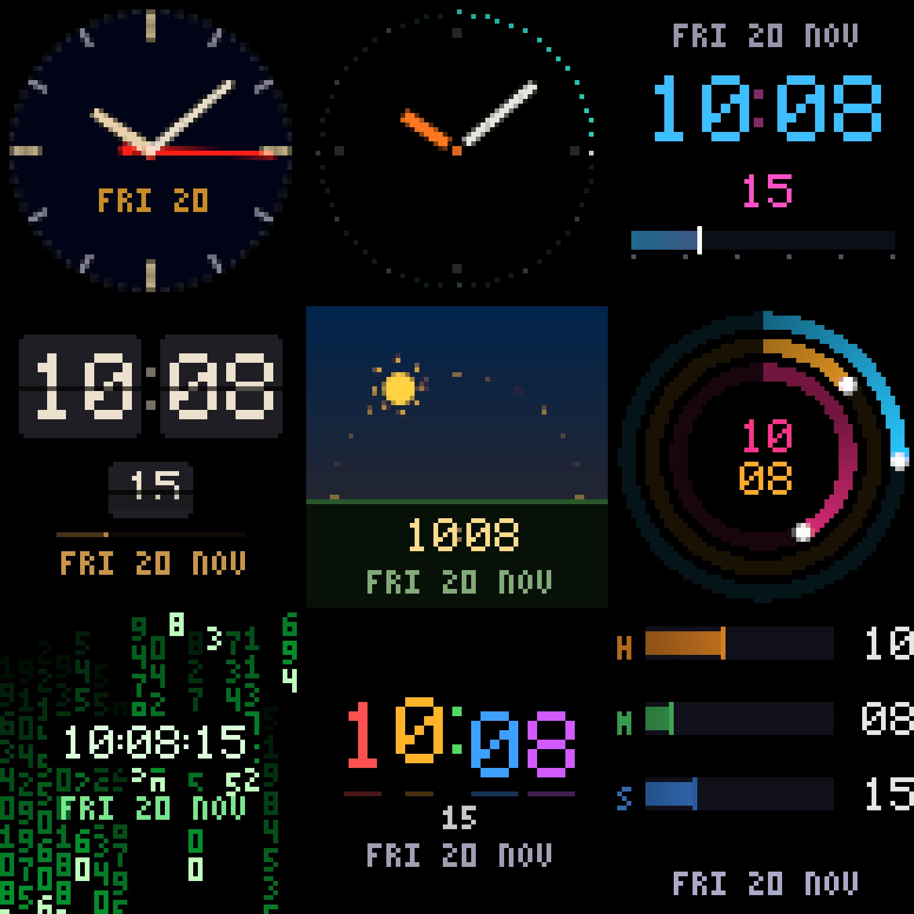

# Clock screen

The time in one of nine animated styles, analog and digital, most with room for the date. It needs no entities.
The hands sweep and the digits move at `frame_rate` (10 a second unless set) while the screen is showing.



```yaml
    clock:
      clock:
        style: classic   # classic, minimal, big, flip, sun, polar, rain, bounce or bars
        date: true       # optional: the date too (not on minimal or polar)
      dwell: 30
```

| Option | Default | What it does |
|---|---|---|
| `style` | `classic` | Which face to draw; one of the nine below |
| `date` | `false` | Show the date as well as the time, where the style has room for it (every style but `minimal` and `polar`) |
| `frame_rate` | `10` | Frames a second while showing, so the second hand sweeps and the animation runs; set it lower to save CPU (the generic option, defaulted for this screen) |

The styles, in the order of the picture above:

| Style | What it shows | Date |
|---|---|---|
| `classic` | A navy station-clock face with cream hour and minute hands and a smoothly sweeping red second hand with a counterweight | `FRI 20` below the hub |
| `minimal` | Two floating hands inside a ring of sixty dots that fills through the minute; the current dot pulses and the hub breathes | no |
| `big` | Large cyan digits with a colon that fades each second, the seconds underneath, and a bar that fills across the minute with a travelling sheen | `FRI 20 NOV` on top |
| `flip` | Split-flap cards for the hours and minutes, with a flap animation as the minute turns, a small seconds card flipping every second and a line filling across the minute | `FRI 20 NOV` at the bottom, else the day |
| `sun` | The sun travels a 6am to 6pm arc over the horizon as the hour, the sky colour following the time of day; at night a crescent moon takes the arc among twinkling stars. The time is written on the ground | `FRI 20 NOV` on the ground |
| `polar` | Concentric arcs for the hours (of 24), minutes and seconds, the seconds arc sweeping with a fading tail and a pulsing head on each ring; the hour and minute in the middle | no |
| `rain` | Columns of green digits falling at different speeds behind the time, which sits in a black box | `FRI 20 NOV` under the time |
| `bounce` | Each big digit hops in turn on a wave, its shadow shrinking as it leaves the ground, in colours that cycle every few seconds | `FRI 20 NOV` under the seconds |
| `bars` | The hour, minute and second as three filling bars with the number at the end; the seconds bar creeps smoothly and its leading edge glows | `FRI 20 NOV` at the bottom |

The faces are drawn for a 64x64 matrix; on another size the face is centred and the edges cropped. At night the
screen is dimmed like any other and, as the fast timer pauses at night, it redraws once a second.

Back to the [README](../../README.md#configuration).
