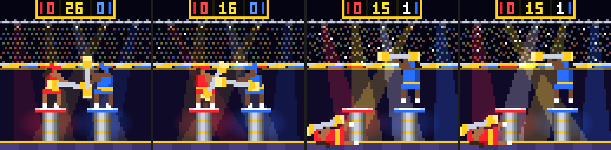

# Duel screen

Two contenders, red and blue, battle with padded sticks on podiums in a lit TV-studio arena (spotlights, crowd, camera flashes) until one falls onto the crash mat and the winner celebrates; a scoreboard counts bouts. It needs no entities. At night it's drawn still.



```yaml
    duel:
      duel:
        seed: 0          # optional: a different number gives a different run
      frame_rate: 5
      dwell: 15
```

Back to the [README](../../README.md#configuration).
