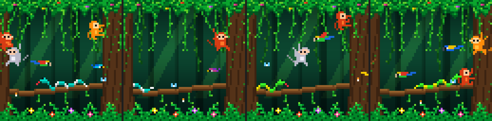

# Jungle screen

An animated jungle: monkeys swing from vine to vine and one climbs a tree, a banded snake slides along a bough,
parrots and toucans fly through and butterflies wander low. It needs no entities. Every time an animal comes in it
gets a random look, side, speed and path. At night it's drawn still.



```yaml
    jungle:
      jungle:
        monkeys: 2       # optional, default 2 swinging monkeys (plus the climber)
        birds: 3         # optional, default 3
        butterflies: 2   # optional, default 2
        seed: 0          # optional: a different number gives a different sequence of animals
      frame_rate: 5
      dwell: 15
```

Back to the [README](../../README.md#configuration).
