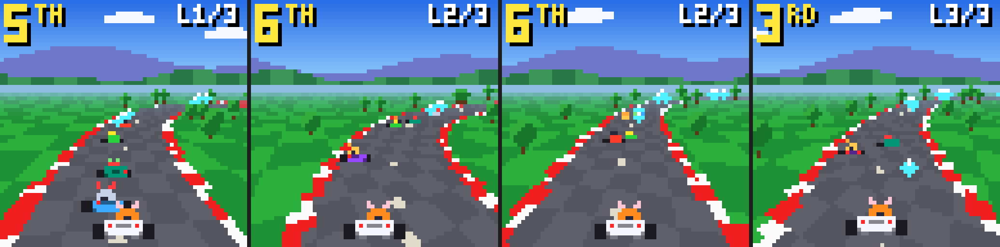

# Kart screen

An auto-playing kart race on a tilted track running to the horizon: six animal drivers race three laps of a circuit built from the seed, with striped kerbs, trees, spark crystals, countdown lights and a finishing panel. Shows position and lap. It needs no entities. At night it's drawn still.



```yaml
    kart:
      kart:
        seed: 0          # optional: a different number gives a different run
      frame_rate: 5
      dwell: 15
```

Back to the [README](../../README.md#configuration).
