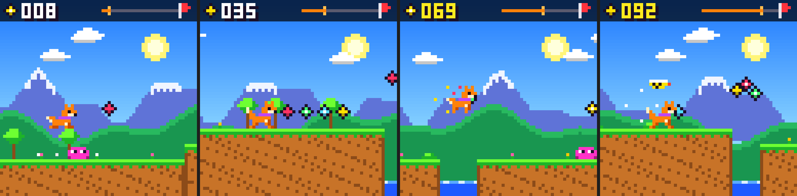

# Platformer screen

An auto-playing early-90s-style platform game: Rusty the fox runs through stages built from the seed, jumping gaps, bouncing on slimes and collecting gems and stars, with a score, a progress bar to the flag and a backdrop that changes from meadow to sunset, moonlight and snow. It needs no entities. At night it's drawn still.



```yaml
    platformer:
      platformer:
        seed: 0          # optional: a different number gives a different run
      frame_rate: 5
      dwell: 15
```

Back to the [README](../../README.md#configuration).
