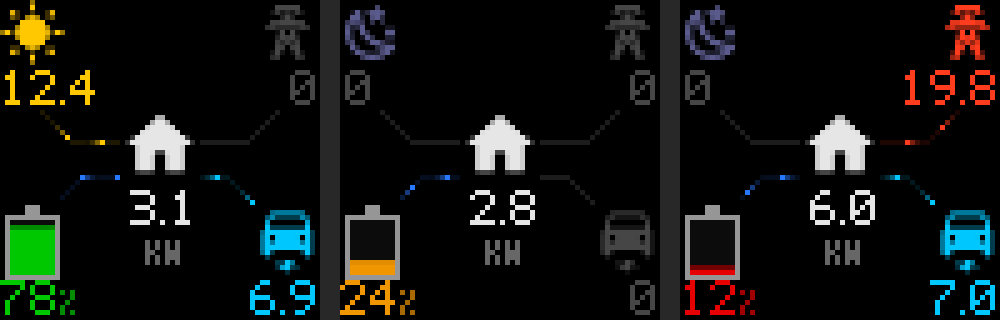

# Power-flow screen

A screen with `power_flow:` shows where the power is going right now: the sun and solar power top left, the grid top right, the battery (filled and coloured by charge) bottom left, the car bottom right, and the house in the middle. Small comets (a bright head with a 3-pixel fading tail, so the direction shows even in a still frame) move along each dim line in the direction of flow, faster with more power. Numbers are kW with one decimal; a small `KW` under the house figure gives the unit once for all of them.



```yaml
  screens:
    power_flow:
      frame_rate: 5                 # redraw 5 times a second while showing, so the comets move smoothly (see below)
      power_flow:
        solar: [sensor.pv_dc_power, sensor.pv_ac_power]   # one entity or a list, added up
        grid: sensor.grid_power     # W, + = importing, - = exporting
        battery: sensor.battery_power        # W, + = charging, - = discharging
        soc: sensor.battery_state_of_charge  # %
        load: sensor.house_load_power        # W
        ev: sensor.ev_charger_power          # W
        load_includes_ev: true      # the load sensor already counts the car: show the house as load - car
        max_kw: 10                  # comets reach full speed at this power
        # night_speed: 1             # comets' pixels a second during the night window
```

| Part | Colours |
|---|---|
| Grid | red while importing, green while exporting, grey when idle |
| Battery line | blue, comets towards the house when discharging and towards the battery when charging; the edge of the fill pulses |
| Car line | always the car's colour (`ev`, light blue) |
| Battery fill and % | `soc_thresholds` (default green from 30 %, orange from 20 %), else `soc_colour` (red) |
| Anything under `idle_w` | grey, with a still, dark line |

| Option | Default | Meaning |
|---|---|---|
| `solar`, `grid`, `battery`, `soc`, `load`, `ev` | | Entities (W, and % for `soc`); any can be left out. Unknown states show `-` |
| `load_includes_ev` | false | Subtract the car from the load for the house figure (on Victron systems with the chargers on the inverter's AC output, `AC consumption` includes them) |
| `max_kw` | 10 | Power at which the comets reach full speed (5 to 10 pixels a second: 1 to 2 pixels a frame at `frame_rate: 5`, so they never seem to run backwards) |
| `night_speed` | 1 | Pixels a second the comets move during the `night` window (the screen is then drawn once every `refresh`); the battery pulse stands still |
| `idle_w` | 50 | Below this a flow counts as idle and shows `0` |
| `soc_thresholds`, `soc_colour` | see above | `[{above: <percent>, colour: [r, g, b]}, …]` and the colour under all of them |
| `colours` | | Override any of `solar`, `import`, `export`, `battery`, `ev`, `house`, `idle`, `line`, `moon`, `outline` |

**`frame_rate`** (any screen): frames per second while that screen is showing, on a separate faster timer; the rotation and every other screen keep to `refresh`. Without it the comets still move, but only once every `refresh`. During the `night` window it's ignored: the screen is drawn once every `refresh` and the power-flow comets creep along at `night_speed`. Each frame is a few milliseconds of pure Python, and DDP is one small UDP burst, so 5 frames a second on several matrices is light work.

Back to the [README](../../README.md#configuration).
