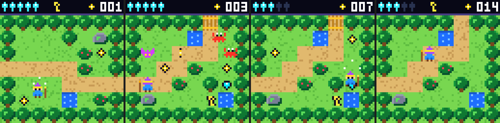

# Quest screen

An auto-playing top-down adventure: Pip the lantern-mage crosses one-screen rooms (meadow, shore, vault), zaps crabs, bats, wisps and beetles with a staff, picks up coins, gems, potions and keys, and the screen scrolls to the next room. Shows energy crystals, the key and coins. It needs no entities. At night it's drawn still.



```yaml
    quest:
      quest:
        seed: 0          # optional: a different number gives a different run
      frame_rate: 5
      dwell: 15
```

Back to the [README](../../README.md#configuration).
