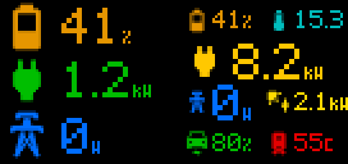

# Rows and grid screens

For more than three items, or items side by side, give a screen a `grid` and a list of `cells`. Each cell takes the same options as a row, plus its position:

```yaml
  screens:
    overview:
      grid: {rows: 4, columns: 2}
      cells:
        - {row: 0, col: 0, icon: mdi:battery-40, entity: sensor.battery_soc, format: percent}
        - {row: 0, col: 1, icon: mdi:thermometer, entity: sensor.outside_temperature, format: decimal1, unit: C}
        - {row: 1, col: 0, colspan: 2, icon: mdi:power-plug, entity: sensor.house_load_power, format: power}
        - {row: 2, col: 0, icon: mdi:transmission-tower, entity: sensor.grid_power, format: power}
        - {row: 2, col: 1, icon: mdi:solar-power, entity: sensor.pv_power, format: power}
```

A cell without an `entity` (or with `show_value: false`) shows just its icon, centred: handy as a label for the cells next to it (e.g. a `mdi:cable-data` cell spanning two rows beside download and upload rates).

Each cell sizes itself: the icon follows the cell height (up to 24 px), and the number uses big digits when they fit, otherwise the small font. The unit is left out if there's no room. `rowspan` and `colspan` merge cells. Screens with `rows` (as above) are a one-column grid.



Row / cell options:

| Key | Meaning |
|---|---|
| `icon` | `none` for no icon, any Material Design Icon as `mdi:<name>`, or a built-in pixel icon: `battery`, `plug`, `pylon`, `sun`, `thermometer` (these work offline) |
| `icon_thresholds` | List of `{above, icon}`, checked top to bottom; the first one the value reaches wins (else `icon`) |
| `font` | `small` always uses the small font (default: big when it fits), so neighbouring cells match |
| `align` | `left` (default), `center` or `right`: moves the icon and the number together within the cell, measured on the pixels actually drawn (e.g. centred temperature rows). Set it on a screen to apply to all its cells; a cell's own `align` wins |
| `show_value` | `false` shows only the icon, centred and coloured by `thresholds` (e.g. a switch's status icon) |
| `icon_size` | MDI icon size in pixels (default: the cell height, max 24) |
| `row`, `col`, `rowspan`, `colspan` | Grid screens only: the cell's position and size (from 0) |
| `entity` | Leave out for an icon-only cell. Any entity with a numeric state, or an on/off state with `format: onoff`. Unavailable or unknown shows `-` |
| `format` | `percent` (0–100, `%`), `power` (W, or kW from 1000 W), `number` (rounded), `decimal1` / `decimal2` (that many decimals), `mbps` (Mbit/s in: `M` with one decimal below 10, whole numbers to 999, then `G` in Gbit/s), `onoff` (shows `on`/`off` for switches, lights and binary sensors; on counts as 1 and off as 0 for `thresholds`), `clock` (minutes after midnight shown as a time, e.g. 402 → `6:42`) |
| `unit` | Override the unit text (characters available: `% W k C ° h M G`) |
| `colour` | `[r, g, b]` default colour |
| `dwell` | Screen level: seconds this screen stays up in the rotation (default: the matrix's `dwell`) |
| `thresholds` | List of `{above, colour}`, checked top to bottom; the first one the value reaches wins, so list the highest first |
| `fill`, `fill_max` | Built-in icons only: fill the icon's fill area in proportion to the value (default max 100) |
| `icon_colour` | Draw the icon outline in a fixed colour instead of the row colour |

Back to the [README](../../README.md#configuration).
