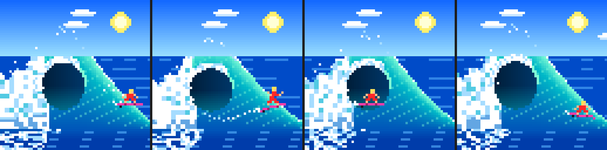
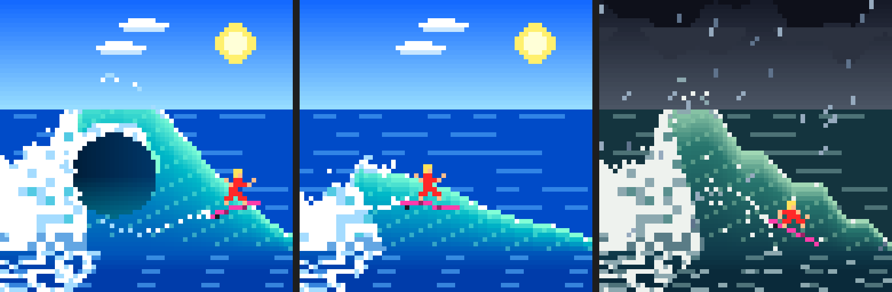

# Surf screen

A surfer riding a breaking wave, seen side-on: paddling in, popping up, carving up and down the face, then a kick-out or a wipeout. It needs no entities. At night it's drawn still.



The three wave styles (barrel, rolling, storm):



```yaml
    surf:
      surf:
        wave_style: barrel   # barrel (default), rolling or storm
        wave_size: 1.0       # 0.6 to 1.4
        sky: auto            # auto, day, sunset, night or storm (time_of_day also works)
        surfer: auto         # auto, sandy, dark, red or silver
        wetsuit: auto        # auto, a colour name, "#rrggbb" or [r, g, b]
        board: auto          # as wetsuit
        wipeouts: 0.35       # share of rides ending in a wipeout (0.6 for storm)
        ride_seconds: 22     # length of one ride (minimum 12)
        seed: 0
      frame_rate: 5
      dwell: 15
```

Back to the [README](../../README.md#configuration).
