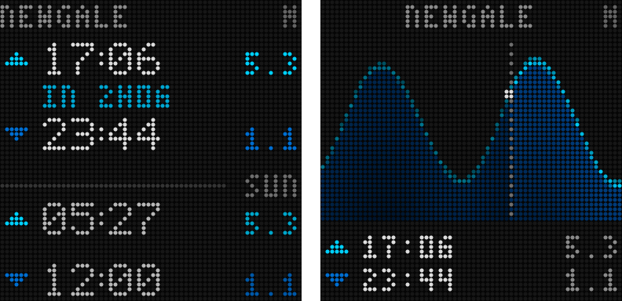

# Tide screen

A screen with `tides:` shows high (▲) and low (▼) waters from an entity that lists them, with heights in metres (a small `M` in the top-right corner gives the unit once). Two layouts:

- `list` (default): the next four, time in large digits and height, `IN 2H06` under the next one, and a line with the day's name before the first of another day's.
- `curve`: today from 00:00 to 24:00 with the sea filled in, a dotted line and a dot for now and the past dimmed, with the next high and low below. Between high and low the curve is a half-cosine (within a few centimetres of the real tide on most UK coasts).



```yaml
  screens:
    tides:
      tides:
        tides: sensor.solva_tide    # the entity with the list of tides
        attribute: predictions      # the attribute holding it
        label: NEWGALE              # shown top left (or centred over the curve)
        layout: list                # list | curve
```

| Option | Default | Meaning |
|---|---|---|
| `tides`, `attribute` | `predictions` | The entity and its attribute: a list of `[time, height]` pairs (as the [UKHO Tides](https://github.com/ianByrne/HASS-ukho_tides) integration gives, for ADMIRALTY's UK stations), or of dicts |
| `time_key`, `height_key`, `type_key` | `time`, `height`, `type` | Field names when the items are dicts. A type like `HighWater`, `high` or `H` marks a high; without a type, highs and lows are worked out from the neighbouring heights |
| `data_time_zone` | UTC | Time zone of times that don't carry one (UKHO Tides gives UTC). Times are shown in Home Assistant's time zone |
| `label` | | Place name |
| `layout` | `list` | `list` or `curve` |
| `max_height` | highest tide + 10 % | Top of the curve, in metres |

With no tides to come (entity missing or empty), the screen shows the label and `NO DATA`.

Back to the [README](../../README.md#configuration).
