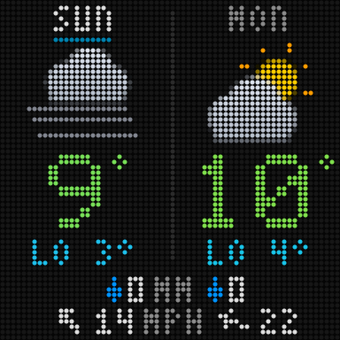

# Weather screen

A screen with `weather:` shows today and tomorrow side by side: the day (today underlined), an animated icon (sun rays twinkle, rain falls, mist drifts), the high in big digits and the low, coloured on a Met Office-like scale (purple below −5 °C, blue at 0, teal at 5, green at 10, yellow at 15, orange at 20, red from 25), then the rain and the wind with an arrow pointing the way it blows. Rain and wind units are printed once, between the two days.



```yaml
  screens:
    weather:
      frame_rate: 4                 # redraw 4 times a second while showing, for the animation
      dwell: 15
      weather:
        weather: weather.home       # any HA weather entity with a daily forecast
        wind_unit: mph              # mph | kmh | ms | kn
```

| Option | Default | Meaning |
|---|---|---|
| `weather` | | The weather entity. The app calls its `weather.get_forecasts` action (a local Home Assistant call) |
| `forecast_interval` | 900 | Seconds between forecast fetches (a minute after a failed one) |
| `forecast_type` | `daily` | The forecast type to ask for |
| `wind_unit` | `mph` | Unit the wind is shown in; the entity's own unit (`wind_speed_unit`) is converted |
| `animate` | true | `false` for still icons |
| `animation_speed` | 2 | Icon frames a second (there are 3) |

Icons are drawn in code for sunny, clear night, partly cloudy, cloudy, fog, rain, snow and lightning; other conditions use the nearest. Rain is in millimetres (one decimal under 10 mm). The frame only changes with the icon's animation step and the forecast, so it's drawn once per step and reused. At night (the `night` window) the icons stand still.

Back to the [README](../../README.md#configuration).
